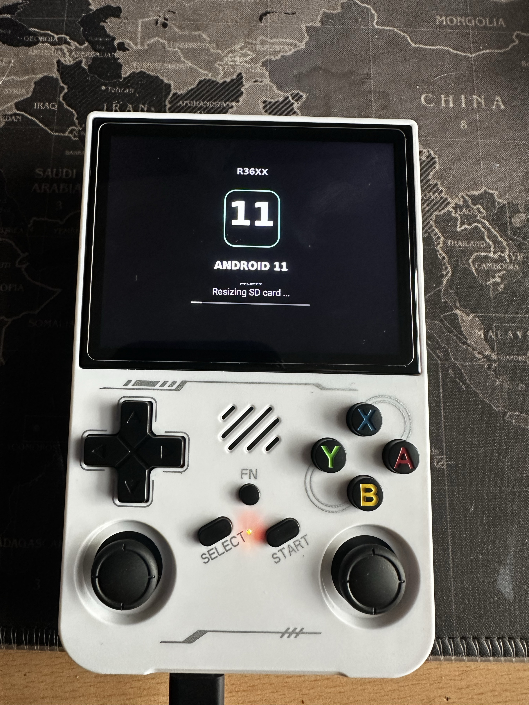
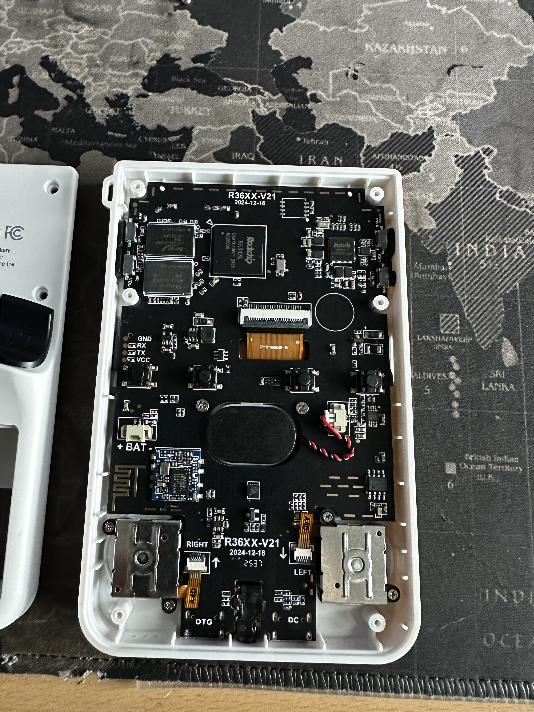

# R36XX

Hardware documentation for my R36XX handheld with a **R36XX-V21** board marked **2024-12-18**.

This documentation was prepared with AI assistance from eight user-supplied photographs. Printed chip markings are recorded as visual evidence; runtime platform identification and firmware compatibility have not been established by these photos.

## Android 11 startup photo

The screen shows **R36XX**, **ANDROID 11** and **“Resizing SD card …”**. This documents a startup stage. It does not establish completion of resizing, Android framework startup, a working launcher or a particular Android build.

## Hardware at a glance

| Item | Photographic evidence |
| --- | --- |
| Enclosure model | R36XX |
| Board revision | R36XX-V21 |
| Board date marking | 2024-12-18 |
| Main chip marking | Rockchip RK3326 |
| Power-management chip marking | Rockchip RK817-1 |
| Memory package markings | SK hynix H5TQ4G63MFR; Zentel A3T4GF40ABF |
| Wireless module marking | Realtek RTL8188FTV |
| Display ribbon marking | HL-MP35HD-B-V5 |
| Debug pads | GND, RX, TX, VCC |
| Enclosure battery label | Li-Po 3.8 V, 3000 mAh; actual battery not verified |

See [the hardware documentation and complete photo index](docs/hardware.md) for evidence, limitations and all eight photos.

## Board photographs

All eight original photographs

1. [Board overview](assets/photos/1-Foto-1.jpg)
2. [Main chip, memory packages and display connector](assets/photos/2-Foto-2.jpg)
3. [Board revision, main chip and power-management area](assets/photos/3-Foto-3.jpg)
4. [Upper board and display ribbon](assets/photos/4-Foto-4.jpg)
5. [Lower board, wireless module, sticks and ports](assets/photos/5-Foto-5.jpg)
6. [Rear enclosure label](assets/photos/6-Foto-6.jpg)
7. [Main chip and memory close-up](assets/photos/7-Foto-7.jpg)
8. [Android 11 startup / SD resizing screen](assets/photos/8-Foto-8.jpg)

## Scope and current status

This initial repository documents one photographed board revision. Android version, physical RAM capacity, storage layout, display timing, wireless operation, controls, sound and suspend/resume need independent runtime verification. GA36 results are not evidence of R36XX compatibility.

Only the eight supplied photographs and their documentation are included. No firmware or SD-card images are included.

## Provenance

Photographs supplied by the repository owner on 10 November 2026. Original JPEG files are preserved unchanged. See [NOTICE.md](NOTICE.md) for scope and [photo checksums](assets/photos/SHA256SUMS) for integrity.
