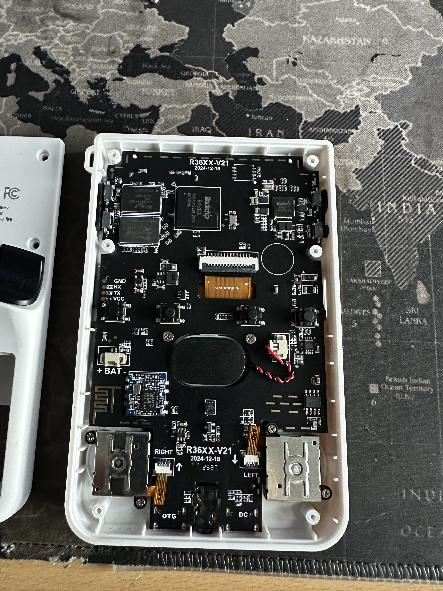
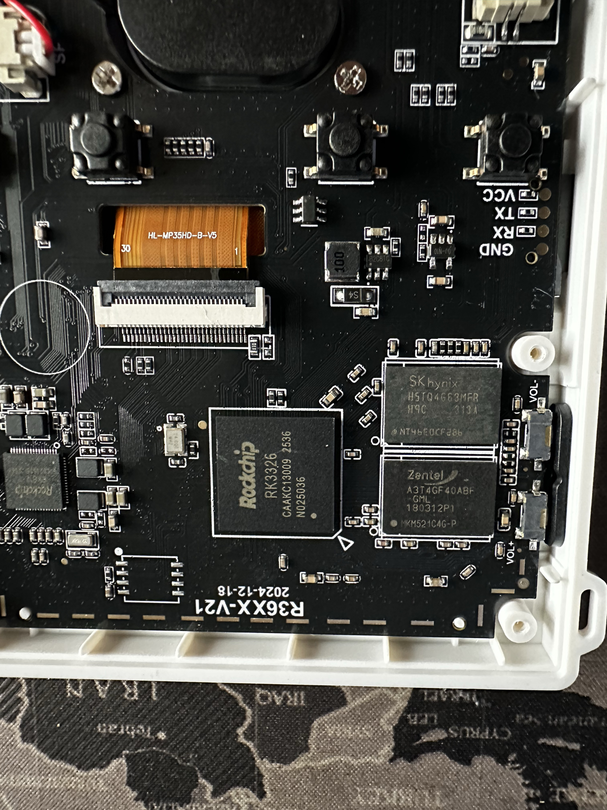
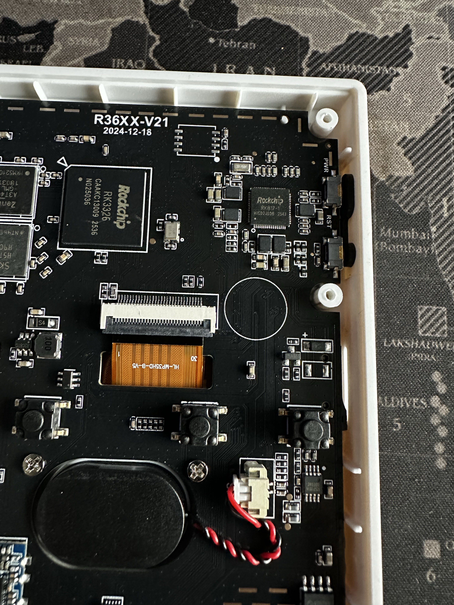
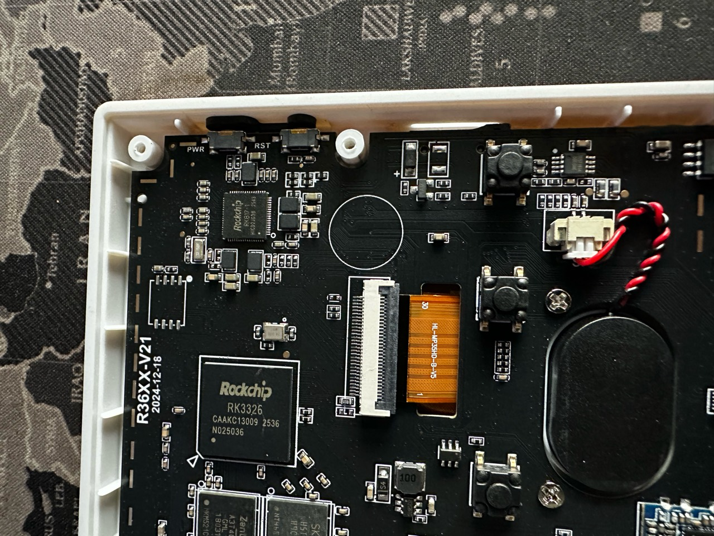
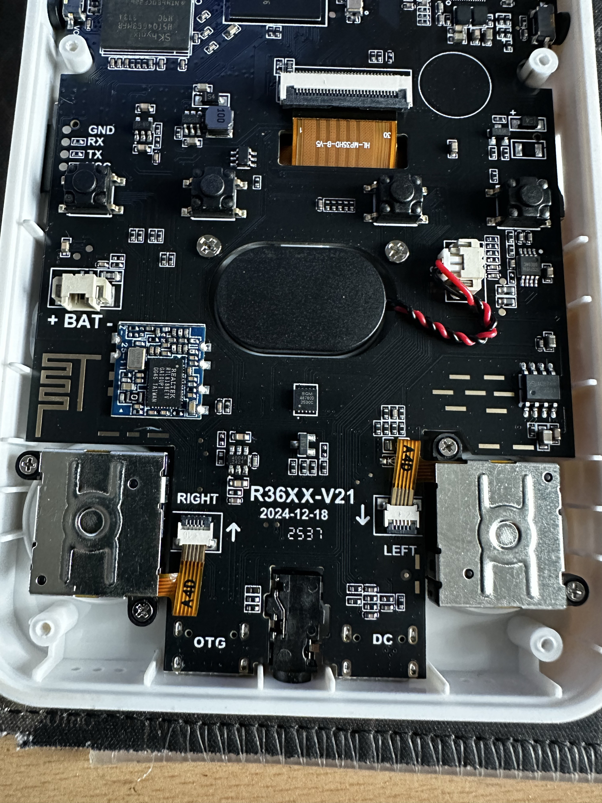
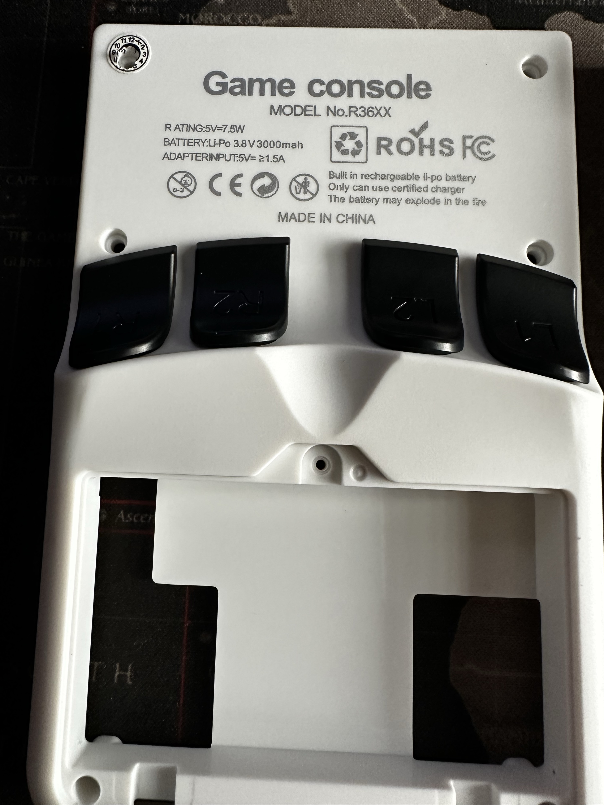
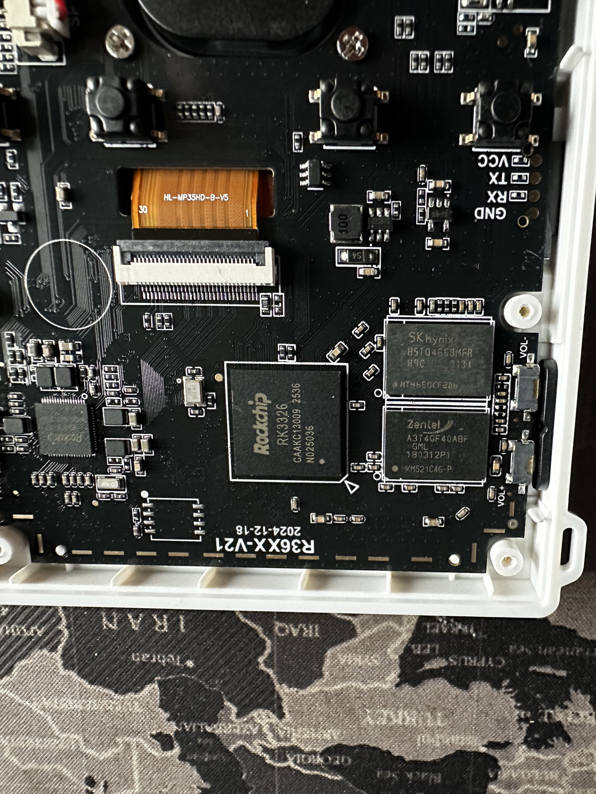
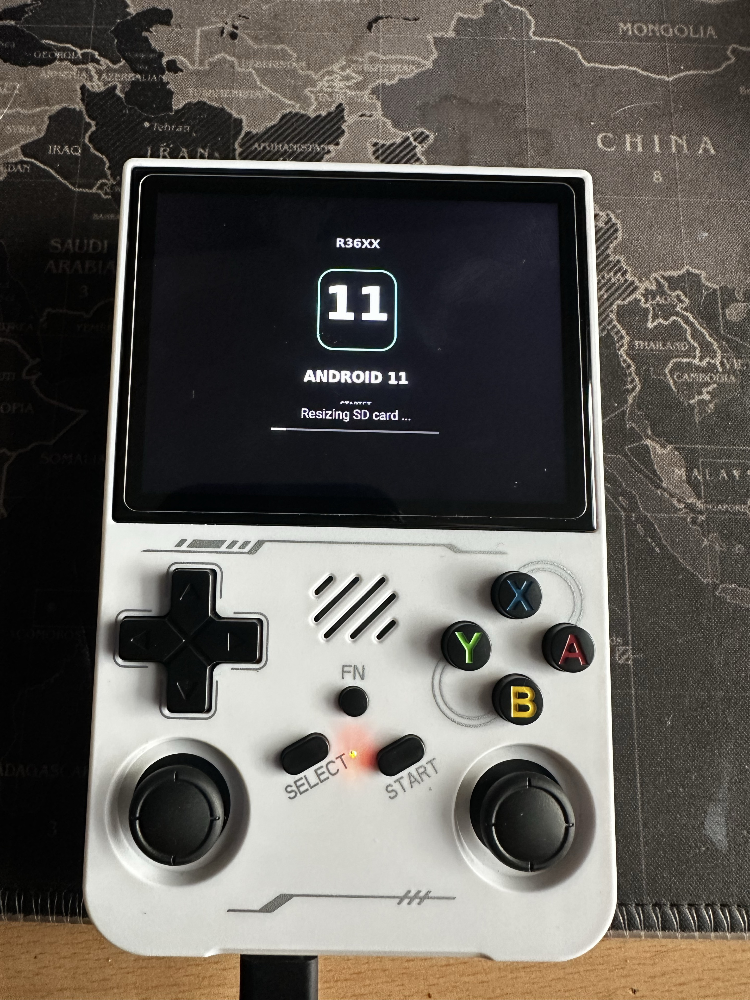

# R36XX-V21 hardware documentation

Documentation date: 10 November 2026. Source: eight photographs supplied by the owner. This is a photographic record of one device, not a schematic or validated firmware specification.

## Identification and visible components

| Area | Visible marking or feature | What is established |
| --- | --- | --- |
| Rear enclosure | Game console; MODEL No. R36XX | Enclosure label only |
| PCB | R36XX-V21; 2024-12-18 | Printed board revision and date marking; not a verified manufacture date |
| Main package | Rockchip RK3326 | Package marking; no runtime SoC identification supplied |
| Power-management area | Rockchip RK817-1 | Package marking |
| Memory package 1 | SK hynix H5TQ4G63MFR | Photographic transcription; capacity and runtime memory remain unverified |
| Memory package 2 | Zentel A3T4GF40ABF | Photographic transcription; exact suffix and configuration should be checked against the original close-ups |
| Wireless module | Realtek RTL8188FTV | Visible module/chip marking and printed antenna; wireless operation not tested here |
| Display ribbon | HL-MP35HD-B-V5; 1 and 30 endpoint markings | Ribbon identification; no verified panel timing, pinout or voltage |
| Debug pads | GND, RX, TX, VCC | Silkscreen labels; voltage levels, direction convention and baud rate unverified |
| Side switches | PWR, RST, VOL−, VOL+ | PCB labels |
| Battery connector | + BAT − | PCB polarity labels |
| Stick ribbons | RIGHT and LEFT | PCB labels in the photographed board orientation |
| Bottom ports | OTG and DC | PCB labels; USB data/host/charging behaviour not established |

The photographs also show an oval speaker with a twisted red/black lead, two metal-backed stick assemblies and a central bottom jack. Exact electrical specifications are not established.

## Enclosure electrical label

Photo 6 reads:

- Rating: 5 V, 7.5 W.
- Battery: Li-Po 3.8 V, 3000 mAh.
- Adapter input: 5 V, at least 1.5 A.

These are enclosure claims. The battery itself is not shown in enough detail to verify its rating or capacity.

## Photo catalogue

All JPEGs retain their supplied bytes and filenames. Relative links open the full-resolution originals.

### Photo 1 — board overview

Shows the board layout, main chip and memory area, display ribbon, labelled debug pads, speaker, wireless module, stick assemblies and bottom ports.

### Photo 2 — processor and memory area

The board is photographed upside down relative to Photo 1. Main chip and memory package markings are visible, along with the display ribbon and debug-pad labels.

### Photo 3 — board marking and power area

Shows R36XX-V21 / 2024-12-18, the RK3326 marking, RK817-1 marking, PWR/RST switches and the display connector.

### Photo 4 — upper board overview

Additional view of the main chip, power-management area, display ribbon and speaker connection. The ribbon reads HL-MP35HD-B-V5.

### Photo 5 — lower board and wireless module

Shows the Realtek RTL8188FTV marking, printed antenna, battery connector labels, speaker lead, RIGHT/LEFT stick ribbons and OTG/DC labels. The visible antenna/module does not establish that Wi-Fi works in the installed software.

### Photo 6 — rear enclosure

Documents the external model and electrical label and four rear shoulder buttons. Enclosure specifications are not electrical measurements.

### Photo 7 — processor and memory close-up

Additional evidence for main-chip and memory markings. RAM capacity must be confirmed from trustworthy runtime records or matched component specifications.

### Photo 8 — Android 11 startup screen

Visible text: R36XX, ANDROID 11, Resizing SD card … . The progress bar is visible. A still image cannot determine whether resizing completed, whether the device remained at this screen, or whether Android became usable. No build identifier, kernel version or runtime logs are supplied by this image.

## Verification still needed

- Runtime SoC/platform, kernel and Android build identification.
- Physical RAM and storage layout.
- Display driver/timing and panel compatibility.
- Input mapping, both sticks, sound and wireless operation.
- USB/OTG and charging behaviour.
- Reliable startup, SD-resize completion and suspend/resume.

No debug-pad voltage or firmware flashing instructions are inferred from these photographs. The GA36 project is a documentation-style reference only; its hardware, builds and test results must not be transferred to this device.

## Integrity and provenance

The owner supplied all eight photographs in this chat on 10 November 2026. Documentation is AI-assisted and distinguishes readable labels from unverified behaviour. [SHA256SUMS](../assets/photos/SHA256SUMS) records the original JPEG hashes.
